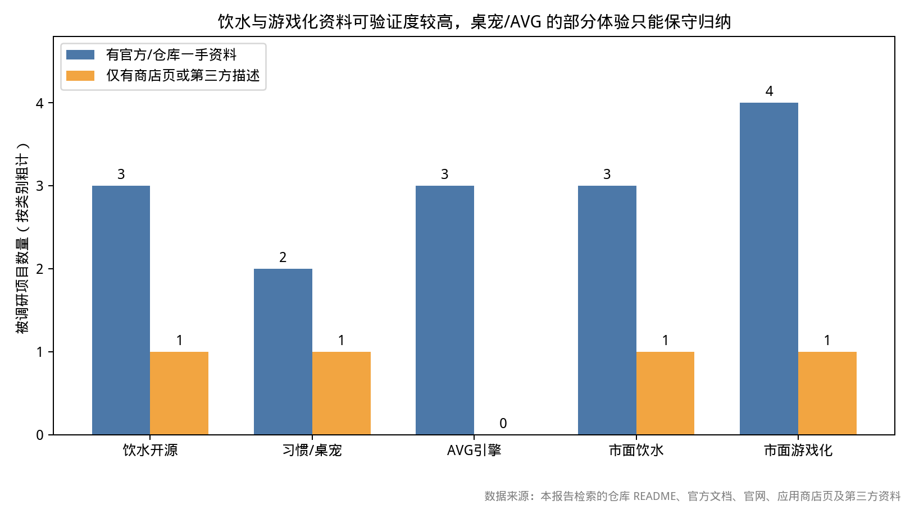
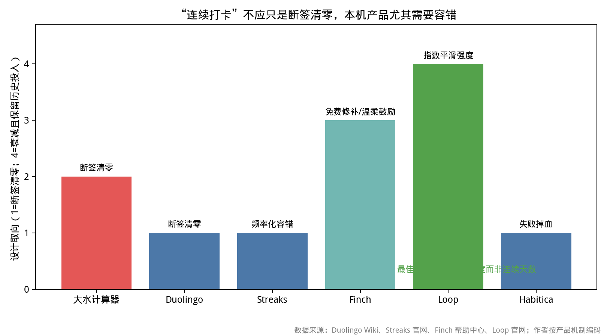

# 「大水计算器」同类项目调研与优化建议

## 摘要

截至 2026 年 11 月 12 日，可查证的同类产品高度集中在三条路径：一是以 Plant Nanny、WaterMinder、Hydro Coach 为代表的饮水记录与角色反馈；二是以 Habitica、Finch、Forest、Streaks 为代表的习惯游戏化；三是以 WebGAL、Monogatari、Ren’Py、NaniNovel 为代表的 AVG 数据驱动叙事。大水计算器的真正优势不是“提醒”，而是把**单文件 HTML、零 CDN、离线、localStorage 与不上传**作为完整体验约束，并把饮水记录、天气/情绪语录、桌宠、AVG 结局和防作弊抓拍缝进一个文件。这个定位在竞品中很少见，但这一结论只对**纯本地单文件形态**成立：作者在 B站 Toy 上架的版本有平台云存档与分数榜，联网能力由平台提供而非自建后端，因此“云存档 / 跨设备同步 / 平台榜”在 Toy 形态下应重新解禁（见「零点：部署形态修正」）。Apple Health / Health Connect 一类跨平台健康数据同步仍不成立。

最值得先做的是三项：把 30 分钟固定提醒改成“基于活动窗口、时段预算和漏喝风险”的节奏；把一次打卡改为含量、时间、设备状态、来源与本地审计哈希的防篡改流水；把断签清零改成有上限的“可信水合指数”，同时保留首次断签免费修复。**【落地状态 2026-11-12】这三项已全部实现**，见 `大水计算器-合并版-说明.md` 的「P0 三条链路增补」章节。音效默认关闭是正确选择，且适合继续用 Web Audio 合成；体积增长则更适合通过自动化校验、资源清单和 Canvas 图层预算控制，而不是引入构建链。[1][2][3]

**补充后新增一条 P0-0**：给同一个 HTML 加一层「Toy 能力探测 + 自动降级」适配层——检测到平台 SDK 才启用云存档与分数榜，检测不到就完全走 localStorage，保持「一个文件拷走就能玩」。

## 零点：部署形态修正（2026-11-12 用户补充）

> 用户补充：「我在 Toy 上架，有云存档」。原报告把「无后端、不上传」当成了唯一部署形态，据此判定的「云存档 / 服务器榜一律不成立」需要按形态分叉重写。作者自己的 `qingcong-rhythm` 仓库说明里已写有「B站 Toy 平台层（排行榜 / 云存档 / 体力）」，属于已有工程经验，不应被当作应放弃的功能。[用户仓库 README]

**两种形态，一个 HTML。**

| | A · 本地单文件版 | B · Toy 上架版 |
|---|---|---|
| 运行方式 | 双击 / localhost / 离线 | Toy 容器内，平台注入 SDK |
| 存档 | `localStorage`，零上传 | 平台云存档为主，`localStorage` 为镜像与降级 |
| 榜单 | 本机多档案榜 | 平台分数榜 + 本机档案榜双轨 |
| 用户身份 | 本机档案名 | 平台用户资料（昵称 / openid），不自建账号 |
| 联网 | 天气 / 可选大模型，均可选 | 平台 SDK 调用；业务数据不自建服务器 |
| 失败降级 | —— | SDK 未就绪 / 未授权 / 报错 → 静默回退本地，玩法不中断 |

**可查证的平台能力。** Toy 容器会注入 JavaScript SDK，公开文档列出的接口方向包括分享、云存储、分数、二维码、摄像头与麦克风、输入内容安全等，调用前可用 `available()` 判断当前是否在 Toy 容器。[21] 开源封装 `bilibili-toy` 把这些能力收敛成 `toy.ready()` / `user.profile()` / `cloud.set()` / `cloud.get()` / `rank.submit()` / `rank.list()`，并说明宿主未就绪（"toy id not available on host"）会做重试、开发态可用 Mock 完全不发 RPC。[22] 另有 B站小游戏开放数据接口 `bl.setUserCloudStorage` 明确规定托管数据上限：**每个用户每游戏最多 128 个 KV 对，每项 key+value 不超过 1 KB、key 不超过 128 字节，且需 `order` 字段用于排序**。[20] 需注明口径：该文档属于「哔哩哔哩小程序 / 小游戏」开放数据接口，Toy 网页部署形态的云存储配额未在本次检索中核实；按更保守的 1 KB / 项做分片设计是安全的，不应把两套配额混为一谈。

**打包约束对本项目的直接影响。** Toy 发布按扩展名白名单打包，允许 `.html/.css/.js/.json/.png/.jpg/.webp/.ogg/.mp3` 等，白名单外文件会直接导致打包失败。[21] 大水计算器把 61 张 WebP 与 4 段 ogg 全部内嵌为 data URI，最终只有一个 `.html`，天然合规，不需要拆资源目录。

**上云边界（重要）。** 云存档只放「最小可重建状态」，不要整包上传 `localStorage`：

- ✅ 可上云：schema 版本、每日饮水流水摘要（量 / 时间 / 来源 / 审计哈希）、今日积分与结算成绩、Rank 结局与 CG 解锁 **id**、形象选择、心情枚举、设置项、水合指数、校验和。
- ❌ 不上云：奶茶抓拍照片（base64 体积大且属敏感影像）、OpenAI 兼容接口 Key、精确 GPS 经纬度（最多保留省市区名称，且需用户同意）、通知 / 摄像头授权状态、完整语录上下文。
- 关键：照片与完整流水始终留在本机；云端即使丢档，也能靠本地镜像 + 摘要重建进度，但不能重建照片。

**结论修订对照。**

| 原报告结论 | 修正后 |
|---|---|
| 服务器实时榜、跨用户榜不成立，需破坏约束 | **Toy 形态解禁**：平台分数榜可接；但它是客户端提交成绩，无服务器反作弊，卡面与文案不得宣称「官方认证」 |
| 云存档、跨设备同步不成立 | **Toy 形态解禁**：平台云存档 + 本地镜像 + 冲突时以「重新读取、不自动以空档覆盖」为准 |
| 好友互访、多人实时交互 | **仍不成立**：本次检索未找到 Toy 开放的实时多人 API；第三方媒体报道称暂未开放（未核实），按「不成立」处理 |
| Apple Health / Health Connect / Google Fit | **仍不成立**：平台隔离，且超出本项目定位 |
| 分享卡校验码语义 | **双轨**：本地版保持「本机校验码」；Toy 版加「平台成绩 + 本地审计摘要」两行，明确「客户端休闲成绩展示」 |

**新增风险（原报告没覆盖）。** ① 云写入的「结果未确认」语义：取消请求不等于撤销已发出的写入，超时也不能证明云端没提交，因此读档必须「重新读取后继续」，不能用空结果覆盖本地。[23] ② 平台接口未见版本比较写入（CAS），多设备同时编辑会互相覆盖，产品层应提示「单设备编辑」并用「双代索引 + 校验和」做冲突检测（第三方项目实践，非官方文档，未核实）。③ 分数榜首次提交通常需玩家点击并经过平台授权，应缓存榜单、只在结算 / 保存时写入，遇限流做指数退避，不写死共享配额（第三方项目实践，未核实）。④ 摄像头抓拍在 Toy 版若改用平台能力，仍须默认关闭、拍完即停流，且照片不进云档。

## 调研范围、方法与局限

本报告信息检索截止日为 **2026 年 11 月 12 日**。项目名、机制、价格、音效策略、离线与隐私做法均尽量取自 GitHub README、官方文档、官网、App Store 或 Google Play 页面。未能取得官方资料的，只作机制推断，并标注“未核实”；没有核实的项目不会填入 star 数、下载量、融资额或用户量。公开页面还会随地区、版本、账号状态而变化，因此“官方页当前描述”不等于所有用户实际可见。产品页或第三方介绍与未实测的体验也分开处理，尤其不会把“隐私承诺”等同于已审计代码。

被调研对象分为四类：一是饮水提醒类产品，二是习惯养成与游戏化产品，三是桌面宠物与陪伴型产品，四是 AVG/视觉小说引擎及单文件网页游戏。GitHub 上大量仓库是个人提交、演示项目或黑客松作品，维护频率、issue 质量与代码成熟度差异很大，因此不能仅按 star 数比较；本文只将仓库作为机制样本，不宣称它们都适合直接 fork。用户补充 Toy 上架信息后，另补检了 B站小游戏官方文档、Toy SDK 说明与开源 SDK 封装；平台配额、授权流程、限流码等以官方文档为准，第三方项目实践与媒体报道一律标注「未核实」。

*图 1：调研样本的一手资料覆盖情况（按类别粗计）。数据来源：本报告检索的仓库 README、官方文档、官网、应用商店页及第三方资料。*

## 一、饮水提醒类产品：增长曲线、角色反馈与健康平台是三条主流

饮水提醒产品的共同结构是“设定目标—提醒—记录—反馈—历史”，但反馈方式差别很大。Plant Nanny 把摄入转化为植物成长，WaterMinder 把角色、水量等级和提醒绑定，Hydro Coach 则更偏向健康平台与统计。大水计算器的水滴形象本质上与 Plant Nanny 的“你喝水，植物就长”同源，但前者还把进度条、角色、提醒与语录合在一个形象里，认知成本更低。[4][5][6]

**Plant Nanny 证明“生命感反馈”有效，但不值得复制社交和广告体系。** Plant Nanny 的公开商店资料强调个性化目标、提醒时间、饮水历史、植物与花盆收集；这是一种低摩擦的情感奖励，比“今日已喝 1200ml”更容易让人回访。对大水计算器而言，水滴本身已经兼任进度条，下一步不应只是再加一个植物，而要让形象阶段、表情、台词语料和轻微动画形成一致反馈。Plant Nanny 的更多内容、订阅或广告路径没有在本次资料中核实，也不属于单文件项目的优先事项。

**WaterMinder 最值得学的是“按当前时间判断应达进度”，而不是固定 30 分钟间隔。** 官方资料称其提醒会适配体重、活动、天气，并在达到目标后停止；App Store 页面还列出 50 多个角色、好友进度分享、Apple Health、小组件、挑战和成就。[5] 这意味着成熟产品把“你应该在什么时间点喝多少”放在“每半小时提醒一次”之前。大水计算器已有实时天气，可直接计算理想累计水量，再与实际累计量比较；若用户落后于当前时段，才触发提醒。它能减少重复打扰，也能解释“为什么现在提醒”。

**Hydro Coach 的优势是健康生态整合，但这类优势在大水计算器约束下不成立。** Hydro Coach 官方页面说明其可在 Android 上通过 Health Connect 读写饮水数据，适合已经使用多个健康应用的人。[6] 然而 Health Connect、Apple Health、Google Fit 和跨设备云同步都依赖平台 API 或账号体系，与“无后端、不上传、数据只在本机”冲突。这里应明确放弃。更好的替代是提供一次性 JSON 导出、导入与版本迁移，让换设备由用户主动搬运文件完成，而不是产品悄悄同步。

| 产品 | 记录与提醒 | 成长/激励 | 社交与分享 | 可借鉴点 | 不应移植 |
|---|---|---|---|---|---|
| Plant Nanny | 目标、提醒、历史 | 植物与花盆成长 | 未核实 | 生命感反馈、角色状态 | 复杂收集与付费墙 |
| WaterMinder | 智能提醒、到量停止 | 50+角色、挑战、成就 | 好友进度、小组件 | 时间进度差、目标可视化 | Apple/Android 生态云同步 |
| Hydro Coach | 智能/间隔提醒 | 天气与活动目标、统计 | 未核实 | 天气纳入目标 | Health Connect 自动同步 |
| Nudge | 间隔提醒、Pomodoro | 进度环 | 无 | 单一健康入口 | 后台服务依赖 |
| LeanTrack | ICS 日历提醒 | 体重/热量/蛋白/饮水趋势 | 无 | 完全本地、导出 | 账号云同步 |

## 二、本地优先与单文件开源样本：数据可迁移比“联网”更有竞争力

开源侧存在一批“浏览器即可运行、数据留在本机”的项目，它们与大水计算器共享隐私立场，但多数只解决了局部问题。Nudge 用纯 HTML/CSS/JS 做水、休息、番茄钟和通知；LeanTrack 是 PWA，强调完全本地、离线、无账号、可导出 JSON；HydroBloom 把植物随摄入变化、周历史和徽章放进 localStorage。[7][8] 这些项目共同说明：不联网并不妨碍做出反馈、徽章、历史、提醒和主题，真正的产品问题是长期数据是否可迁移、提醒是否可调、状态是否能恢复。

**本地优先的核心不是“没有服务器”，而是用户能验证、导出和迁移。** LeanTrack 的官方仓库明确把“100% local、offline-first、no account”列为价值主张，并提供 JSON 导入/导出。[8] 大水计算器应把这一思路延伸到每一次提交：写入前生成 schema 版本、本地日期、时间戳、饮水量、来源和顺序号；导出时包含可读 JSON、人类摘要和校验和。这样即使浏览器清空 localStorage、文件被复制到其他设备，用户也能判断哪些记录完整、哪些可疑，而不是看到一串无法解释的积分变化。

**纯前端项目的代表性痛点是 `file://`、fetch、Service Worker 与资源预加载之间的冲突。** Monogatari 的官方设置文档说明，虽然可以双击打开 `index.html`，但离线支持、Service Worker、资源预加载及通过 fetch 加载文件等功能需要经 HTTP 提供。[9] 这解释了大水计算器选择“所有资源内嵌、单文件运行”的工程价值：它绕开文件系统同源问题，同时天然兼容无网环境。代价是文件体积、内存与资源失效风险必须由构建期工具处理，不能靠运行时从网络补资源。

**AVG 的工业化写法应学习，复杂构建链不必照搬。** WebGAL 用脚本文件定义场景，支持 `changeScene`、`callScene` 与 `choose`，并明确场景切换后舞台音乐、立绘、背景不会自动清除。[1] NaniNovel 与 Monogatari 也把变量、条件、分支、存档、回滚或本地化做成引擎能力。[2][3] 大水计算器目前已是单文件，把整个引擎搬进来会损害约束；但可提取统一事件脚本：`{id, next, conditions, effects, flags, choices}`。剧情、结局和 CG 用数据驱动后，4 个形象、6 个 Rank 结局与 CG 图鉴就是内容表，而不是更多散落的 `if/else`。

## 三、习惯游戏化：奖励要即时，惩罚要容错，社交应低压力

Habitica、Finch、Forest 和 Streaks 不是直接竞品，却分别代表四种留存设计。Habitica 将习惯、每日任务、待办和奖励分开，完成任务给经验值和金币，漏掉每日任务会掉血，并允许组队、派对和 Boss 任务。[10] Finch 把完成目标变成宠物能量、冒险、故事、发现和换装，官方帮助文档称连续打卡“用于鼓励温柔的一致性而非完美”，并会按持续签到提供免费修复。[11] Forest 把专注分钟变成树，退出会枯萎，组队中一人放弃则整片林受损。[12] Streaks 则把任务、频率和提醒做到极简，支持非每日任务，并通过 iCloud 而不是开发商服务器共享。[13]

**惩罚能增加压力，也会把健康记录变成失败焦虑。** Habitica 的掉血机制对愿意承担 RPG 风险的用户有效，但饮水本身受会议、睡眠、运动和不适影响，单次漏记不该让角色受到不可挽回的打击。大水计算器现有“偷喝奶茶抓拍”的戏谑惩罚，适合保留为剧情表达，不应让普通饮水漏记连续降低角色属性。更稳妥的是：连续完成获得温和增益，漏记只暂停增益；严重作弊才触发 AVG 事件或一次性 Rank 风险。

**容错不是放水，而是保护历史投入。** Streaks 允许任务按周或自定义频率进行，因此休息日不会自动清零。[13] Finch 提供免费 streak repair。[11] Loop 公开资料描述的“习惯强度”采用更平滑的升降模型，漏掉一天会降低强度但不清零。[14] 大水计算器当前 30 分钟冷却和防作弊定位很鲜明，但“连续打卡”如果直接清零，会鼓励用户手动补录假数据，反而破坏其重视可信打卡的设计。建议用 **可信水合指数（0–100）** 取代只看连续天数：每次合格记录按时间衰减地增加，长时间无记录下降；连续高分触发 Rank 线索、CG 提示与剧情资格，连续低分只触发关怀事件。

*图 2：连续打卡韧性编码。1=断签清零，2=频率化容错，3=免费修补/温柔鼓励，4=指数平滑强度。数据来源：Duolingo Wiki、Streaks 官网、Finch 帮助中心、Loop 官网；作者按产品机制编码。*

**社交分两形态：本地版止于本机档案，Toy 版可接平台分数榜。** WaterMinder 的好友共享、Habitica 的队伍、Forest 的组队共植都依赖账号、云端关系或设备生态。[5][10][12] 大水计算器的「今日榜 + 历史总榜」在纯本地形态下是同设备多档案榜，已能成立；Toy 上架形态则可用平台 `rank.submit` / `rank.list` 做跨用户成绩展示。[22] 分享卡在两种形态下都保留档案名、日期、可信分、校验和，但语义要分开：本地版写「本机校验码」，Toy 版写「平台成绩 + 本地审计摘要」，且都注明「客户端休闲成绩展示，非官方认证」。好友互访、组队共植、多人实时交互仍按不成立处理（见零点章节）。

## 四、桌宠与虚拟形象：陪伴感来自可预测反应，不是素材数量

桌宠类产品普遍围绕可拖动形象、点击/悬停反应、语音、闹钟和多角色展开。Desktop Mate 官方商店页面强调角色会坐到窗口、跟随光标、点击或抚摸播放语音、闹钟提醒，并可缩小、躲到屏幕边缘以减少打扰。[15] Pawse 是开源 Mac 桌宠，强调无账号、无网络、不追踪，宠物按日程来访，可选“硬阻断”提醒。[16] 这些产品的关键不是角色数量，而是让每次出现都显得有原因、有情绪、可结束。

**水滴形象的优先级应从“更多皮肤”转到“同一形象的多状态”。** 4 个形象已经满足基础选择，但每条状态至少应有 idle、提醒前、提醒中、完成、落后、偷喝、低能量、解锁 CG 八类反应。形象切换不应重置成长；切换只改变视觉层，核心档案共享水合指数、Rank 进度和事件标志。WebGAL 关于舞台不会自动清理的提醒尤其值得警惕：单文件内如果直接切换角色资源，旧立绘、音效、动画计时器可能残留。[1] 应建立“舞台事务”，角色更换时统一卸载计时器、Canvas 图层、背景音乐和语音节点。

**每日轮换不是成本很高，就不应成为主要养成线。** 更省资源的是“主题轮换 + 一个主形象”。每天根据天气、心情、Rank 或完成度轮换表情、配件、气泡颜色和小动作；每周或每月开放一个可解锁 CG，而非持续要求新增大图。所有 WebP 记录尺寸、图层数和首次解析耗时；超过预算时自动降低非主形象的采样或延迟加载，但“延迟加载”在单文件内只能通过解压/解码时机实现，不能从网络加载。

**防作弊与大水计算器的独特人设应分开设计。** 每 30 分钟冷却是低成本的第一层；摄像抓拍可以做成第二层“高可信事件”，但必须明确它是戏谑证据，而不是生物识别认证。摄像头权限、拍照开关、拍照原因、保存时长、删除按钮应集中在一个面板，并默认关闭。抓拍后生成本地证据 ID，包含事件类型、时间、随机数和 SHA-256 摘要；只有用户主动分享时才导出。绝不上传原图、视频、定位和天气明细。这样一来，“防作弊”不是让产品更严厉，而是让水合指数在用户自己眼里更可信。

## 五、AVG 与单文件网页游戏：内容数据化、状态可回滚、资源可校验

Ren’Py 是成熟桌面/移动视觉小说引擎，官方称其使用脚本语言并支持 Python，已用于数千部作品；但其发布物并不天然是单文件网页。[17] WebGAL 使用脚本文件和资源预加载，支持场景、分支、调用和选择。[1][18] Monogatari 强调“视觉小说首先是网页”，提供变量、动作、组件、保存和本地化，但明确指出 `file://` 对离线、Service Worker 和 fetch 的限制。[2][9] NaniNovel 则把场景写成文本文件，内置分支、变量、条件、存档、回滚、历史和 CG 画廊。[3]

**大水计算器的 AVG 层适合“微型脚本 + 全局 flag”，不适合大引擎。** 建议定义三类脚本：剧情节点、Rank 结局条件、CG 图鉴解锁条件。节点只描述文本、角色表情、选项、音效、自动保存点和副作用；结局条件读取水合指数、连续表现、事件 flag、天气与心情，但不读取可外部篡改的随机值作为唯一决定因素。6 个 Rank 结局可用“基础资格 + 主要倾向 + 容错余量”判定，防止用户因一次偶然漏记被锁死在坏结局。

**CG 图鉴应有两条解锁路径。** 第一条是正向剧情解锁；第二条是低水合指数触发的“观察记录”，确保失败也有内容。每条 CG 记录 `id、解锁日期、触发原因、所需 Rank、是否已读、资源哈希`。已经解锁的 CG 导出时可仅带 id，避免把完整 data URI 复制到文本文件；导入时按当前单文件资源清单重新校验。这样既支持跨设备迁移，又不会制造一份可绕过解锁的“图鉴存档”。

**单文件不等于放弃工程化，但工程化只能在构建期发生。** 建议仓库维护 `src/`，通过脚本把 CSS、JS、音频转码结果、WebP 和剧情 JSON 打包为单一 HTML；构建同时输出 `manifest.json`（每项资源大小、宽高、时长、SHA-256、用途）、`changelog`、文件总字节数、预估内存峰值和静态校验报告。运行时使用 Subresource-style 内容校验没有必要，但可用启动时 `DOMContentLoaded` 到首次可交互时间、资源对象数量、localStorage 用量和最近一次异常做匿名自检。自检默认留在本地，不发送任何数据。

## 六、机制横向对比：大水的优势在约束，而不在功能广度

| 维度 | 市面/开源主流做法 | 大水计算器当前状态 | 建议取舍 |
|---|---|---|---|
| 提醒节奏 | 固定间隔、智能提醒、到量停止 | ✅ 时段进度差 + 达标停催 + 免打扰 | 已落地；固定间隔仍可切回 |
| 免打扰 | 时段、周末、健康平台、专注模式 | 已有提醒基础 | P0：会议/专注/睡眠窗口、延期次数上限 |
| 防刷 | 平台记录、人工打卡、弱校验 | 30 分钟冷却、抓拍 | P0：审计流水与本地哈希；保留戏谑性 |
| 数据可信 | 云端账号或平台同步 | ✅ 同步哈希审计链 + 链头进分享卡/云档 | 已落地；冲突只标注不冻结 |
| 排行/社交 | 好友、队伍、跨端云榜 | 本机多档案 | 本地版保持本机榜；Toy 版解禁平台分数榜，实时多人仍不成立 |
| 云存档 | 账号同步 / 平台托管 KV | 纯本地 | P0-0：Toy 形态接平台云存档，SDK 不可用自动降级 |
| 分享卡 | 成绩、贴纸、小组件 | ✅ Canvas + 校验码 + 离线复核凭证 | 已落地；凭证不声称权威认证 |
| 形象成长 | 植物/宠物/角色升级、换装 | ✅ 4 形象共用统一状态层 | 已落地；切换不改业务数据 |
| 剧情 | 分支、变量、存档、CG | 6 结局、CG 图鉴 | P1：数据驱动节点与回滚 |
| 音效/音乐 | 合成、环境音、语音、默认各异 | 内嵌 ogg + Web Audio，默认关 | 保持默认关；P1 做合成与单实例管理 |
| 体积校验 | 多文件、PWA、资源预加载 | 全内嵌单文件 | P0：构建期资源清单与体积预算 |
| 隐私/离线 | 本地、账号云、平台同步并存 | 本地版零上传；Toy 版最小摘要上云 | 核心卖点改为「敏感数据永不上云」：照片 / Key / 精确定位只留本机 |

> **音效默认策略说明**：本报告核查的本地优先样本中，公开资料对「默认开 / 默认关」的说明并不完整，未核实部分不作断言；可确认的是网页端桌宠普遍提供音量与静音控制。这部分数据未单独制图，避免把「资料未核实」误画成「默认关闭」。大水计算器沿用「默认全部关闭 + 用户显式开启」的策略。

**音效默认关闭应继续坚持，但理由应从“怕吵”升级为“尊重用户预期”。** Pawse 提供角色语音，dsh-fat-fish 在运行时合成提醒音，表明本地桌宠未必完全没有声音。[16] 但大水计算器运行在网页、包含多形象和重复提醒，默认静音更符合“不打扰工作”的桌宠定位。用户主动开启后，保存 `master、music、sfx、voice` 四档独立值，并允许按事件选择“仅一次/会话/总是静音”。抓拍事件、偷喝事件和 AVG 关键剧情可默认只振动或视觉反馈，除非用户开启语音。

## 七、P0：先修可信度、提醒有效性和单文件可维护性

**P0-0：加一层 Toy 能力探测 + 自动降级（本次补充后新增，优先级最高）。做什么：** 在同一个 HTML 里写 `const TOY = window.toy || ...`，`toy.ready()` 成功后才启用平台能力；把存档抽象成 `Store.get() / Store.set() / Store.merge()` 一个接口，底下两条实现：本地 `localStorage` 永远可用，Toy 云档只在容器里挂载。结算时 `submitScore` 只提交「总分 + 达标时刻 + 规则版本」三个数；读档按「先本地、再云、冲突重读、绝不空档覆盖」。**为什么：** 用户已在 Toy 上架且平台有云存档，原报告「放弃云存档」的结论对上架版不成立；同时不能因为接了平台就破坏「双击 HTML 也能玩」。[20][21][22][23] **怎么改：** 云档只存最小可重建摘要（≤ 1 KB/项保守分片，含 schema 版本与校验和），照片、API Key、精确坐标排除在外；SDK 未就绪 / 未授权 / 报错一律静默回退本地，界面上用一枚小标签写明「本地档案 / 云存档 / 降级中」，不弹错误打断玩法。**【落地状态 2026-11-12】已实现**：见 `大水计算器-Toy上架适配方案.md`，14 组回归 0 发现项 / 0 控制台错误；适配层增量 23.1 KiB（超出方案中 <20 KiB 的预估，已如实留档）。

**P0-1：把“固定 30 分钟提醒”改为“当前进度差 + 可用窗口”提醒。做什么：** 计算当日理想累计水量曲线；每次提醒时比较理想值、实际值、距睡眠/结束时间、上次饮水、专注模式、连续漏提醒次数。达到当日目标后停止重复提醒；连续 2 次忽略只升级一次“柔性提醒”，不变成轰炸。**为什么：** 固定间隔会在完成目标后仍打扰，也会在刚喝水时重复提醒。WaterMinder 的到量停止与时段适配说明成熟产品已采用这一逻辑。[5] **怎么改：** 增加一个纯函数 `nextReminder(state, now)`，用一组可解释规则而非大模型生成；离线语录引擎只在真正弹出时选文案，不参与调度。**【已落地】** `reminderDecision(now)` 用 7:00–22:00 分段预算（早 30% / 中 50% / 晚 20%）算此刻应达量，落后 ≥250ml 才提醒；达标停催、22:00–07:00 免打扰、连续忽略 2 次只升级一次柔性提醒；设置里可切回固定间隔，另有「专注 30 分钟」延期（每日上限 3 次）。

**P0-2：饮水记录改成不可任意改写的审计流水。做什么：** 每日记录从“时间戳+量”升级为 `entry{id, createdAt, localDate, amountMl, source, cupId, eventFlags, deviceEntropy, prevHash, hash}`，当天累计由流水重算。30 分钟冷却只限制“点击即确认”的快速来源；健康自报、手工修正、抓拍证据分别标记。**为什么：** 这既保留防作弊，也允许诚实补录与审计。简单累加器容易被直接改 localStorage，玩家自己也会失去对数据的信任。**怎么改：** 用一个私钥随机串做 HMAC 不合适，因为密钥会公开；改用确定性 SHA-256 链和独立 UUID，接收方校验顺序与重复即可。发现冲突时冻结当前档案、生成修复副本，不让脚本静默覆盖。**【已落地，实现有取舍】** 用同步 FNV 链（`seq / prevHash / hash / localDate / auditSource`），`file://` 下也能跑、不引入异步；老存档一次性补链但不改任何原始字段。冲突时**不冻结档案**（会阻断喝水玩法），而是在 HUD 标「⚠ 审计链在第 N 笔断开，原记录已保留」，并把链头写进分享卡与 Toy 云档供离线复核。

**P0-3：建立“可信水合指数”和首次断签免费修复。做什么：** 完成一杯按时间权重增加指数；连续两小时空白按缓慢衰减；天气热、心情差、偷喝奶茶只影响低风险事件 flag，不直接清零。达到里程碑送“修复券”，也可观看一段 AVG 短剧情恢复一次连续状态。**为什么：** 断签清零会诱导补录，反而削弱防作弊。Finch、Streaks 和 Loop 的共同方向是让频率与容错更可见。[11][13][14] **怎么改：** 保留积分、榜单和 Rank 用于趣味层，但主进度显示水合指数；可设历史最高、本周趋势和“恢复可能性”。**【已落地】** 指数 = 今日完成度 55% + 打卡节奏 20% + 近 7 天均值 25%，新用户给 15 分信任基线；漏记只按空白时长缓慢回落（夜间不计），奶茶 −3 / 连打 −2 不清零；里程碑 60/80/95 送修复券，用券抵消一小时空白衰减。

**P0-4：音效与抓拍都改为显式授权、即时试听、会话可关。做什么：** 第一次启用 BGM 前说明需要用户手势；每条语音/曲目提供播放、停止、试听和音量条；摄像头抓拍明确权限、用途、删除入口与“只存本机”。**为什么：** 默认关闭已符合网页体验，但缺少授权状态和生命周期管理会导致切换页面、切形象或重复点击时声音叠加。**怎么改：** 一个 `AudioBus` 管理三类音轨和中断；一个 `MediaPolicy` 拒绝未授权抓拍，摄像头流在拍照后立即停止。

**P0-5：给单文件加入构建期资源清单与体积预算。做什么：** 在仓库里设置硬上限（建议 3–5MB 起步，随测试调整），WebP、ogg、字体和脚本分别设预算；导出 `manifest.json` 与启动自检页。**为什么：** 全部内嵌虽然解决离线，却会把体积、解码和内存问题隐藏到发布后才发现。Monogatari 的 HTTP/fetch 限制也反向证明单文件是优势，不是技术落后。[9] **怎么改：** 构建脚本报告每一项增量；超出预算时阻断 CI，而不是运行时悄悄压缩。

## 八、P1：让成长、剧情与分享形成低成本的闭环

> **【落地状态 2026-11-12】** 本节 P1-1 / 1-2 / 1-3 / 1-4 / 1-5 已全部实现，收进一个「🗂 数据 / 凭证中心」弹层（导入导出 / 复核凭证 / 传纸条 / 状态自检 四个 tab）。实测 12 组回归 0 发现项 / 0 控制台错误，详见 `大水计算器-合并版-说明.md` 的「P1 增补」章节。其中 P1-3 的凭证按设计**只证明内部自洽、不声称权威认证**；P1-2 沿用已有的 `ST_ENDINGS` 数据表并加自检，未引入构建链。

**P1-1：把 4 个形象做成“一套状态、四种视觉”。做什么：** 抽象出情绪、姿势、气泡、配件、背景与音效槽位；每次状态变化只下发数据，不复制逻辑。形象切换不改变水合指数、档案、CG 与 Rank。**为什么：** 当前多形象若不统一状态，容易出现提醒语、动画和进度不一致。**参考：** WebGAL 的舞台继承和清理问题说明状态残留会直接影响叙事与声音。[1] **怎么改：** 写一个 `CharacterDirector`，每次 setState 都返回旧的待卸载资源列表；支持降级模式，低性能设备只播放 idle 与关键帧。**【已落地】** `characterState()` 统一心情 / 进度 / 立绘 / 气泡 / 音频槽，`characterDirector(next,prev)` 返回 `unload / load / dataSignature`；`renderAll()` 包装后每次刷新过一次状态层。「状态自检」tab 逐一 setState 4 形象并比对业务数据签名，实测 4/4 一致。

**P1-2：用 JSON 微型脚本重写剧情、选项和结局。做什么：** 至少迁移 AVG 首章、偷喝事件、连续成功事件、Rank 结局与 CG 图鉴规则。每条节点包括 `text、emotion、choices、setFlags、requireFlags、effects、savePoint`。**为什么：** 当前逻辑散落在脚本中会增加新增语录、调试和本地化成本。**参考：** WebGAL、Monogatari、NaniNovel 都以文本/变量/条件/分支构成内容层。[1][2][3] **怎么改：** 引擎代码和数据分开；运行时禁用脚本中的任意 `eval`，只允许声明的命令与效果。**【已落地（轻量版）】** 原 `ST_ENDINGS` 已是 6 条 rank 表（含 `cond` 判定与 `judge` 文案），枢纽 8 个选项保持数据数组；新增 `storyDataAudit()` 校验 rank 唯一、条件可调用、CG keys 有效、运行时零 `eval`。没有把整个引擎搬进来，避免损害单文件约束。

**P1-3：分享卡从“结果截图”升级为可离线复核凭证。做什么：** Canvas 卡保留档案名、日期、目标、完成率、可信分、规则版本、随机校验码；同时导出一份可读摘要。接收方可通过同版本脚本重新计算关键摘要。**为什么：** 本地数据容易伪造，单纯截图无法区分记录与装饰。**参考：** 本地版只有本机榜；Toy 版有平台分数榜，但仍是客户端提交，同样不声称权威认证。**怎么改：** 卡面按形态切换一行说明——本地版写「本卡片由本机记录生成，仅供分享」，Toy 版写「平台成绩 + 本机审计摘要，客户端休闲成绩展示」；两版都保留校验和与规则版本号。**【已落地】** 新增 `DW-VOUCHER-1` 文本凭证（规则版本 `DW-R2` + 校验和 + 13 项成绩摘要），分享卡面板可直接生成；接收方在「复核凭证」tab 粘贴后跑 5 项检查（校验和自洽 / 校验码格式 / 字段完整 / 生成时间 / 能证明什么）。凭证不含照片、Key、定位、天气与心情原文；界面明写「只证明按公开规则生成且内部自洽，非官方认证」。

**P1-4：提供导入/导出与“恢复向导”。做什么：** 导出 JSON 时附 schema 版本、应用版本、生成时间和校验和；导入时先预览差异，让用户选择合并、替换或新建档案。删除、覆盖和清空各设置二次确认与撤销窗口。**为什么：** 本地版没有云端回收站，Toy 版云档也可能因写入未确认而回退，误删与跨设备迁移仍是最大风险。**参考：** LeanTrack 把导出、完全本地和无账号作为核心价值。[8] **怎么改：** 数据模型迁移函数采用版本号；旧版本只向前迁移，不回写原文件。Toy 版额外提供「导出本地镜像 → 云档冲突时手动合并」，导入前先预览差异再让用户选合并 / 替换 / 新建档案。**【已落地】** `makeBackup()` 导出 schema 2 镜像（含人类摘要与校验和）；`parseBackup()` 校验 app/schema/checksum 后先预览差异；`dhApply()` 三选一：合并按 id 去重 + 成绩取更高分 + 解锁取并集 + 设置保留当前，替换 / 新建先存 `KEY+'.undo'` 快照，**5 分钟内可撤销**。镜像含抓拍照片与 API Key，UI 明确提示自行保管。

**P1-5：建立本机多人/多档案的轻度社交。做什么：** 保留多档案榜，增加“传纸条”模式：一个档案写一句离线鼓励，生成二维码或文本凭证，另一台设备导入后由接收档案的宠物朗读。**为什么：** 这能复制好友鼓励的情绪价值，却不要求账号、网络或服务器；Toy 版若有分享 / 二维码能力，可把同一张凭证由平台直接分享出去，逻辑不用重写。[21] **参考：** WaterMinder 的好友进度、Finch 的 good vibes 都是正向反馈，不是强竞争。[5][11] **怎么改：** 凭证只携带昵称、日期、鼓励语和校验码；不携带饮水历史、天气、定位、抓拍或完整心情原文。**【已落地】** `DW-NOTE-1` 文本纸条只带 6 个字段（版本 / app / 日期 / 昵称 / 一句话 / 生成时间）+ 校验和；另一台设备粘贴导入后桌宠 `say()` 朗读。实测字段集合与敏感词扫描均通过。

## 九、P2：提升内容深度、无障碍与可玩性，但不扩张工程复杂度

**P2-1：把“抓拍自首通知书”做成可收集的合规事件册。** 每项记录时间、触发原因、是否删除、法律玩笑边界；增加明确的“数据只留在本机”说明，避免把偷喝事件写成惩罚威胁或医疗判断。可参考 WebGAL 的分支与 CG 概念，把通知书、语录和 CG 统一成事件资产。[1]

**P2-2：做“天气—心情—完成模式”的可解释回顾。** 每周只生成三条结论，例如“午后落后多于晨间”“心情低时更常漏记”，但规则必须简单、可回放、不冒充医学建议。天气只作为提醒节奏因素，不宣称推荐饮水量具有医疗依据；WaterMinder 也在商店页明确其目标只是估算。[5]

**P2-3：增加低成本无障碍与输入容错。** 所有拖拽动作都提供点击替代；提醒至少支持视觉、声音、振动三项开关；角色状态有足够文字说明；音效面板保留降低、单声道和暂停选项。四形象之间要满足足够对比度和色盲可读，不能只靠颜色区分状态。

**P2-4：建立“可选 AI”的安全边界。** OpenAI 兼容接口应是完全可选的远程增强，默认关闭；请求前明确发送内容、模型地址、用途和费用风险，默认只发送模板后的最小化上下文。离线引擎永远保留并作为主路径。绝不能让联网接口成为记录、提醒、剧情或恢复数据的必要条件。

**P2-5：做仓库与开发日记的最小工程治理。** 作者已有单文件网页游戏、开发日记、P0/P1/P2 和 GitHub Projects 的习惯，可进一步把每条开发日记关联到场景/资源 ID、测试步骤、体积变化、性能阈值和回归证据。建议每完成一项 P0 都生成可复现验证清单；不要在单文件里塞入单元测试框架，改用 HTML 内隐藏的“自检页”输出结果。

## 十、哪些做法放弃、哪些按部署形态解禁

**先按部署形态分叉，再谈放弃。** 原报告写成「四类做法一律放弃」是把纯本地形态当成了唯一形态；用户补充 Toy 上架信息后，应改为：

**A · 只在纯本地单文件形态下放弃。** 跨用户实时榜、账号关系网、跨设备自动同步。本地版的价值就是零上传，一旦自建后端就失去辨识度。替代做法：本机多档案榜、离线二维码鼓励凭证、JSON 导入导出。

**B · Toy 上架形态下解禁，但带边界。** 平台云存档（最小摘要 + 本地镜像 + 冲突重读）、平台分数榜（只提交总分 / 达标时刻 / 规则版本，客户端成绩不宣称认证）、平台分享与二维码（同一张离线凭证直接复用）。解禁的前提是**不自建服务器**：能力全由平台 SDK 提供，同一个 HTML 仍能双击运行。[20][21][22]

**C · 两种形态都放弃。** ① Apple Health / Google Fit / Health Connect 自动同步——平台隔离且超出定位。② 多人实时交互、组队共植、好友互访——本次检索未找到 Toy 开放的实时多人 API，第三方媒体报道称暂未开放（未核实），按不成立处理。③ 把抓拍照片 / API Key / 精确 GPS 写进任何云端存储——与上不上架无关，属隐私红线。④ 依靠支付、广告或订阅解锁的复杂换装与资源包——会增加素材管理、版本分裂与用户迁移负担，Toy 平台的商业化能力本次未核实，不纳入建议。

**无论哪种形态都成立的替代做法。** 好友鼓励改成本机档案留言或离线凭证；全球榜改成个人历史 / 本机档案榜 / 平台休闲成绩榜；云同步改成本地镜像 + 用户主动导出导入；健康平台记录改成用户主动输入摘要；AI 个性语录保留离线规则引擎作为主路径，远程模型仅作可选增强。Forest 的组队惩罚、Habitica 的队伍掉血虽然有效，却需要高信任社交关系，大水计算器更适合 Finch 式的温和反馈。[10][11][12]

**最终的优化顺序不是“加功能”，而是修三条链路。** 提醒链路：从固定间隔走向当前进度差、活动窗口和容错上限；记录链路：从可改计数器走向带哈希的审计流水；留存链路：从断签清零走向水合指数、状态形象、AVG 事件和低成本分享凭证。这样能保留大水计算器最具辨识度的“本地、单文件、戏谑又讲规则”的人设，同时把可玩性建立在可信数据和可恢复进度上。

## 引用来源

[1] https://docs.openwebgal.com/webgal-script/scenes.html
> “在跳转场景、分支选择或调用场景后，舞台并不会被清除。这也就意味着上一个场景应用的背景音乐、立绘、背景图片等效果会被继承到下一场景。”

[2] https://developers.monogatari.io/documentation/building-blocks/data-storage
> “Building Blocks — The core concepts: script & labels, characters, variables, actions and components.”

[3] https://naninovel.netlify.app/zh
> “整个场景就是一个纯文本文件，你正看着它运行。”

[4] https://play.google.com/store/apps/details?id=com.fourdesire.plantnanny
> “你喝下的每一杯水，也同時讓植物獲得水分……解鎖並收集各種植物。”

[5] https://waterminder.com/
> “Your hydration goal adapts to your weight, activity level, and even the weather, so your routine feels realistic.”

[6] https://hydrocoach.com?p=5182/
> “Your water intake can become part of your broader health data setup.”

[7] https://www.webkkk.net/Swarup113/Nudge
> “Pure HTML5, CSS3, Vanilla JavaScript – no frameworks or external dependencies.”

[8] https://github.com/nightodaygamestudio/LeanTrack
> “100% local data (no account) Zero friction UX Transparent open source code (MIT) Works on any device (installable PWA).”

[9] https://developers.monogatari.io/documentation/getting-started/quick-start/
> “Several of Monogatari's features… only work when the game is served over HTTP instead of opened straight from disk.”

[10] https://habitica.com/static/overview
> “If you fall into bad habits or miss your Dailies, you will lose Health.”

[11] https://help.finchcare.com/hc/en-us/articles/42149821015693-New-User-Guide
> “Streaks are meant to encourage gentle consistency, not perfection. You'll earn free streak repairs by checking in consistently.”

[12] http://www.forestapp.cc/?startupstash/
> “If you leave the app or use blocked apps during strict sessions, the tree may wither.”

[13] https://streaksapp.com/
> “Some tasks aren't for every day, so choose how often each one needs doing, and your streak is safe on the days off.”

[14] https://loophabits.org/
> “Loop's habit score is based on the frequency and regularity of repetitions, not whether you've completed it on a particular day.”

[15] https://store.steampowered.com/app/1790340/Desktop_Mate/
> “所有功能都经过精心设计，不会打扰你的工作和时间。”

[16] https://github.com/salahu01/pawse-app
> “No account, no internet, no tracking. Free and open source.”

[17] https://www.renpy.org/
> “Ren'Py is a visual novel engine… that helps you use words, images, and sounds to tell interactive stories that run on computers and mobile devices.”

[18] https://docs.openwebgal.com/tech
> “WebGAL 的场景是以文件为单位的，一般来说是后缀名为 .txt 的 WebGAL 脚本文件。”

[19] https://apps.apple.com/CN/app/id653031147
> “超过 50 个角色显示水分状态……与好友分享进度……与 Apple 健康同步。”

[20] https://miniapp.bilibili.com/small-game-doc/api/open/open-data/setUserCloudStorage
> “每个 openid 所标识的用户在每个游戏上托管的数据不能超过 128 个 key-value 对……每一项的 key+value 长度都不能超过 1K(1024) 字节……还需要一个 order 属性，用于 bl.getAllCloudStorage 时的排序。”（口径：哔哩哔哩小程序 / 小游戏开放数据接口；Toy 网页部署形态配额未核实）

[21] https://pygamestudio.com/zh-cn/platform/bilibili_toy
> “容器会注入平台的 JavaScript SDK……调用前可以使用 available() 方法判断当前环境是否为 Toy 容器……SDK —— 分享、云存储、分数、二维码、摄像头与麦克风、输入内容安全等等。”；同页给出打包白名单：`.html/.css/.js/.json/.wasm/.data/.png/.jpg/.jpeg/.gif/.svg/.webp/.ico/.woff2/.mp3/.wav/.ogg/.m4a/.mp4/.webm`

[22] https://npmjs.com/package/bilibili-toy
> “await toy.ready() / rank.submit({score}) / rank.list() / user.profile() / cloud.set({key:'value'})……开发 / 预览模式下完全不发起真实 RPC……宿主就绪重试：对 toy id not available on host 竞态透明退避。”

[23] https://juejin.cn/post/7702828258124103707
> “取消请求不会撤销已发出的远程操作，超时也不能证明云端没有完成提交……网络调用仍应由读档、结算等业务事件触发。”

[24] https://app3.myzaker.com/news/article.php?pk=6a5f50108e9f096d9134989a
> “「Toy」是 B 站从六月份开始启动内测的网页部署平台……平台中现已涵盖的内容包括人格测试、小游戏、网页工具、画册等。”（第三方媒体报道，平台数据未核实）

[用户仓库 README] https://github.com/604665656
> “qingcong-rhythm —— 单文件 Web 音游引擎：4 轨下落、音频分析自动谱面、B站 Toy 平台层（排行榜 / 云存档 / 体力）。”
